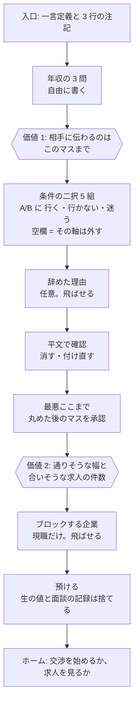

# DESIGN.md — Negocie（ネゴシエ）: 本音を預けられる転職エージェント

- 版: v0.1（2026-10-12）。製品版の UX 設計。見た目は最後（§9）。
- 対象: 製品版（求人マッチング＋条件交渉）。面談・丸め（マス目）・段階開示・開示台帳の仕組みは現行のハッカソン版から引き継ぐ。デモ・攻撃の実演・金庫の確認（TEE）の画面は「詳しく見る」の奥に置く。
- 根拠の文書: `design/anon-negotiation-agent/design.md`（仕組み。承認済み）、`spec.md`（仕様）。この文書は仕組みを変えない。仕組みの上に「どう見せるか・どう触らせるか」を決める。
- 未定のことは「未定」と書き、選択肢を添える（一覧は §12）。
- 用語: この文書では、製品を「Negocie」、利用者を「あなた」、転職希望者を「候補者」、企業側を「求人側」、本音の条件を保管する決定的なプログラムを「金庫」と呼ぶ。

---

## 1. 一言定義と、ユーザーが達成したいこと（JTBD）

**一言定義**: 本音の条件を預けても、相手には「あなたが決めた粗さ」までしか伝わらない転職エージェント。

**ユーザーが達成したいこと**

| # | Job | 言い換え（画面の言葉） |
|---|---|---|
| J1 | 本音の条件（最低年収、当直の上限、辞めたい理由）を、会社にも運営者にも知られずに、「通りそうか」だけ確かめたい | 「言えば通ったかもしれない条件を、言わずに確かめる」 |
| J2 | 在職中に、周囲に知られずに進めたい | 「覗かれても困らない」 |
| J3 | 全部を今決めなくても前に進みたい。決めていない条件は後で聞いてほしい | 「空欄のまま進める。聞かれたら答える」 |
| J4 | 待っている間、今どこまで進んでいて、次に何が起きるか知りたい | 「今は相手の番。次はあなたの確認」 |
| J5 | 渡した情報を、いつ・何を・誰に渡したか後から確かめたい | 「開示台帳」 |

**製品名**: **Negocie（ネゴシエ）**。決定（2026-10-12、ユーザー）。

- 由来: ネゴシエーター（交渉人）を短くした。求職者側にも求人側にも、それぞれの交渉人（エージェント）が付く、という製品の構造を名前にした。
- 名前に「転職」が無いので、名前の直後に必ず一言を添える。添える文（案）:「本音を預けられる転職エージェント」。入口・タブの説明・ストアの説明文で同じ文を使う。
- 表記: 画面では「Negocie」。読みを添えるのは入口の 1 回だけ（「Negocie（ネゴシエ）」）。
- 名前の条件（記録）: 一発で転職用と分かること。求人側・求職者側の双方のために交渉する意味があること。
- 外した案（記録）: フェアオファー、転職なこうど、オファーテーブル、ホンネオファー、ミドル、ダブルエージェント（スパイの連想）、枡・仕切り・際・余白・まるめ・さかい・Ambit（転職と分からない）。
- 商標・ドメインの空きは未確認。公開前に確かめる。

---|---|---|---|
| フェアオファー / FairOffer | 転職の「オファー」を、双方に「フェア」にまとめる | 一発で転職と分かる。両側に偏らない代理、という芯をそのまま言う | 同名のサービスの有無は未確認 |
| 転職なこうど / Nakodo | 仲人は両家の間に立ち、条件をまとめる人 | 「双方のために動く」が日本語で自然に伝わる | 結婚の連想。若年層に古く見える恐れ |
| オファーテーブル / OfferTable | 双方が着く交渉のテーブル | 転職＋交渉の場、が一語で分かる | やや説明的 |
| ネゴシエ / Negocie | ネゴシエーター（交渉人）を短く | 交渉が主役と分かる | 「転職」が名前に無い |
| ホンネオファー / Honne Offer | 本音を預けて、オファーを引き出す | 製品の約束と転職の両方 | 求職者寄りに見える |
| ミドル / Middle | 歩み寄る「真ん中」で合意する | 双方の代理、合意の意味が入る | 転職と分からない |

- 名前の条件（2026-10-12、ユーザー）: 一発で転職用と分かること。求人側・求職者側の双方のために交渉する意味があること。
- 外した案: 「ダブルエージェント」（スパイの連想が信頼と合わない）、「枡」「仕切り」「際」「余白」「まるめ」「さかい」「Ambit」（転職と分からない）。
- 商標・ドメインの空きは未確認（推測を含む）。決める前に確かめる。

---

## 2. ペルソナと利用シーン

語彙（年収・リモート日数・当直回数・昇給見直し・研修・副業・入職時期）が医療職と IT 職の両方を想定しているので、ペルソナも 2 人置く。

**P1: 看護師、32 歳、在職中（夜勤あり）**
- 本音: 当直は月 2 回まで。年収は今より下がらなければよい。今の職場の人間関係が理由だが、それは言いたくない。
- 使い方: 夜勤明けの帰り道、寝る前の 15 分。スマホ、片手、音なし。
- 怖いこと: 同僚に画面を見られる。転職サイトからの通知が職場で鳴る。

**P2: ソフトウェアエンジニア、29 歳、在職中（フルリモート）**
- 本音: 週 3 日以上リモートでないと行かない。年収は 650 万以上。副業は続けたい。
- 使い方: 通勤はないが、昼休みの自席や、家族のいるリビングで開く。PC とスマホを行き来する。
- 怖いこと: 現職の会社に「探している」ことが伝わる。希望年収を先に見せて足元を見られる。

**利用シーン（画面の制約に直す）**

| シーン | 時間 | 制約 | 画面への要求 |
|---|---|---|---|
| S1 通勤・移動中 | 5〜10 分 | 片手、揺れる、途切れる | 1 画面 1 問。途中でやめても消えない |
| S2 寝る前 | 15〜20 分 | 暗い、集中できる | ダークモード。まとまった入力（二択、確認）はここ |
| S3 職場の自席・昼休み | 1〜2 分 | 覗かれる、通知が鳴る | 覗かれて困る表示を出さない。すぐ伏せられる |
| S4 途中確認の通知が届いたとき | 30 秒 | 場所を選べない。期限がある（24 時間） | 通知文面に中身を書かない。開いたら 1 タップで答えられる |
| S5 待っている期間 | 数時間〜数日 | 不安になる | 今どこか・次に何が起きるか・自分は何もしなくてよいか、が一目で分かる |

---

## 3. 初回体験: 最初に得る価値と、そこまでの最短フロー

**最初に返す価値**（優先順）

1. **主: 「この条件なら通りそう」の見立て**。金庫の 3 値（受けられる／受けられない／本人に確認）を、点数ではなく「幅」で見せる。例:「年収 600〜650 万・リモート週 3 日なら、合いそうな求人が 4 件」。
2. **従: 本音の条件に合う求人が見える**。件数と、条件の重なり方だけ。企業名は見せる（求人は公開情報）が、候補者の条件は求人側に渡っていないことを同じ画面に書く。
3. **入力の途中で返す最初の価値**: 年収の 3 問に答えた直後に出る「相手に伝わり得るのはここまで」（丸めた後のマス）。「書いた本音がそのまま相手に行くのではない」と、入力の 1 分後に体で分かる。

**避けること**: 市場価値の目安（単一の数値やランク）。評価されている感が出る。幅や件数で足りる。

**最短フロー**（面談の順番は現行の仕組みどおり。空欄で進めた軸は「外す」扱いになり、交渉中に聞かれたときだけ答える）

**途中でやめたとき**
- 現行の仕組みでは、面談の途中状態は 1 時間使わないと読めなくなり、送信・削除・30 日の自動削除で消える。S1（移動中）とは相性が悪い。
- 製品版の方針: 未定。選択肢:
  - (a) 面談の下書きをサーバ側に残し、期限を 24 時間以上に延ばす。生の値を長く置くので、注記の文言と削除の導線を足す必要がある。
  - (b) 現行どおり 1 時間で切る。切れたときの画面で「年収の 3 問からやり直し。前回の答えは残っていません」と理由を書く。
- どちらでも、画面側は「ここまで答えた」を見せ、戻ったときに同じ問いから再開する。

---

## 4. 主要画面一覧と、各画面の目的・主要アクション・状態

**原則**: 1 画面 1 目的。すべての画面に「戻る」と「伏せる」（§4.11）がある。空／待ち／エラー／成功の 4 状態を画面ごとに定義する。

**ページと画面の対応**（2026-10-13 実装。ページの経路は 5 つ固定なので、製品版の画面はページの中の画面切り替えで作った）

| 製品版の画面 | ページ | 備考 |
|---|---|---|
| オンボーディング | `/` | 製品名・一言・3 行の約束・「面談を始める」。その下に 3 つの場所のカード（求職者・求人側・セキュリティテスト。試験で固定）と注記。金庫の確認（TEE）は「詳しく見る」に畳む（`/#tee` で開く） |
| 面談 | `/interview` | 1 問 1 画面。手順の順番と API は設計書 §5 のまま |
| ホーム（概要） | `/me#view-home` | 「あなたの番」（途中確認・判定後）→ 統計タイル → 状態の箱 → 2 カラム（交渉／求人と渡しているもの） |
| 求人一覧 | `/me#view-jobs` | 既存の `/v1/jobs`。判定は出さない（§4.4 の (b)） |
| 求人分析 | `/me#view-analysis` | サンプルの数字（本物の求人データは無い）。分布と「あなたの条件に当たる帯」だけ。点数・順位は出さない |
| 交渉状況 | `/me#n/<交渉 ID>` | 途中確認を最上段、現在地の 3 行、活動ログ、段階開示（`#slot-stages`） |
| 開示設定（台帳を含む） | `/me#view-disclosure` | 渡していないもの／渡し得るもの／渡したもの／取り消せないもの → 開示台帳（`#slot-ledger`）→ 並べて見る画面（`#slot-fr39`）。初めて開いたときに読み込む |
| データ削除 | `/me#view-delete` | 1 回の確認で全部を消す |
| 通知設定 | （作らない） | 提出版は通知なし。ホームの最上段が代わり |
| 詳しく見る: 仕組み／金庫の確認／デモ／攻撃 | `/`（TEE）、`/demo`、`/attack` | 文言だけ §7・§8 に合わせた。構造は試験で固定 |
| 求人側の画面 | `/demo` | 製品版の求人側の認証は未定（U-D4） |

ナビは 3 つの組（求職者・求人側・セキュリティテスト）で、全ページ共通。ヘッダの 1 行目は製品名と「伏せる」。

### 4.1 オンボーディング

- 目的: 30 秒で「何が相手に伝わり、何が伝わらないか」を理解して面談に入る。
- 主要アクション: 「面談を始める」。副: 「詳しく見る」。
- 内容: 一言定義、「伝わるのはマス目まで」「生の値は預けた後に捨てる」「面談中の AI 処理は Google Cloud で行われ、一定期間記録され得る」の 3 行。断定語は使わない（§7）。
- 状態

| 状態 | 表示 |
|---|---|
| 空 | この画面が空状態。注記 3 行とボタン 1 つ |
| 待ち | 「面談を始める」を押してセッション発行まで。ボタンを押せなくし、1 行「準備しています」 |
| エラー | 混雑（429）: 「今は混み合っています。数分後にもう一度」。注記は読める |
| 成功 | 面談の 1 問目へ遷移 |

### 4.2 面談（チャット風の 1 問 1 画面）

- 目的: 本音を、短い問いの積み重ねで預ける。
- 主要アクション: 「次へ」「飛ばす（この条件は後で聞かれたら答える）」「戻る」。
- 問いの構成: 年収 3 問（自由記述）→ 価値 1 → 二択 5 組 → 辞めた理由（任意）→ 平文で確認 → 最悪ここまで → ブロック先（任意）→ 預ける。
- 空欄のルール: 二択の軸を飛ばすと、その軸は「外す」扱い（事前には答えず、交渉中に聞かれたら答える）。画面に「この条件は相手に先に知られません。代わりに交渉中に聞かれることがあります」と 1 行。
- 外しすぎの警告（現行どおり）: 受けられる組み合わせが 0 件なら、「このままだと事前に受けられる組み合わせがありません。二択に戻るか、このまま進むか」を選ばせる。
- 状態

| 状態 | 表示 |
|---|---|
| 空 | 問いと入力欄。例文を薄く（「額面で年 620 万くらい」）。必須の印は付けない |
| 待ち | AI の読み取り中（最長 60 秒）: 入力欄の下に「読み取っています」。入力は消さない。30 秒を超えたら「もう少しかかります」 |
| エラー | 読み取り失敗: 「読み取れませんでした。そのまま次へ進むか、言い直すか」。本文が長すぎ: 文字数の上限を示す。セッション切れ: 「1 時間使わなかったので、最初から」 |
| 成功 | 読み取った値を表で見せ、「これで合っていますか」。合っていなければその場で直せる |

### 4.3 ホーム（進捗）

- 目的: 開いた瞬間に「今どこ・次に何・自分は何をする」が分かる。
- 主要アクション: 進行中の交渉を開く／途中確認に答える／求人を見る／面談をやり直す。
- 構成: 上から「あなたの番」（途中確認・会う・承認があるときだけ）、進行中の交渉 1 件、合いそうな求人の件数、最近の出来事 3 件。
- 状態

| 状態 | 表示 |
|---|---|
| 空 | 面談は済んだが交渉なし: 「条件を預けました。合いそうな求人が n 件あります」と「求人を見る」。面談も未了: オンボーディングへ |
| 待ち | 交渉中で相手の番: 「相手の番です。あなたは何もしなくて大丈夫。次に開いたとき、動きがあればここに出ます」と最終更新時刻 |
| エラー | 読み込み失敗: 前回の内容を薄く残し、「更新できませんでした」と再読み込み |
| 成功 | 判定が出た: 「見込み: 高」と組み合わせ 1 つ、次の操作（会う） |

### 4.4 求人一覧・詳細

- 目的: 本音の条件に「合いそうか」を幅で見て、交渉を始める相手を選ぶ。
- 主要アクション: 一覧: 絞り込み（公開情報の軸だけ）。詳細: 「この求人と交渉を始める」「この企業をブロック」。
- 見せ方: 「合いそう／確認が要る／合わない」の 3 区分。点数・順位・偏差値は出さない。
- 計算の置き場所: 未定（U-D6）。金庫には「任意の組み合わせを評価するだけの口」が意図的に無い（設計書 §3.3。金庫を答え合わせの道具に使われないため）ので、金庫に聞く案は採れない。選択肢:
  - (a) 本人向けに読める丸め済みの条件（`GET /v1/principals/{pid}/policy`。すでに本人の画面で使う口）と、求人の公開条件を `web` か画面側で突き合わせ、本人にだけ見せる。金庫の予算も使わない。
  - (b) 一覧では判定を出さず、求人の公開条件と本人の「最悪ここまで」を並べて見せるだけにする。「合いそうか」は交渉を始めた最初の確かめで分かる。
  - 提出版（2026-10-15）は (b)、その後 (a) を足す、が現実的な順。
- 状態

| 状態 | 表示 |
|---|---|
| 空 | 合いそうな求人が 0 件: 「今の条件では合う求人がありません。条件を広げるか、しばらく待つか」。評価しない文にする |
| 待ち | 一覧の読み込み: 枠だけ先に出す。詳細の「交渉を始める」: 作成まで「準備しています」 |
| エラー | 読み込み失敗。ブロック済み企業の求人は一覧に出さない（出てしまったときのエラー文は「この企業はブロック中です」） |
| 成功 | 交渉が作られ、交渉状況へ。「相手に渡ったのは、あなたの条件ではなく『受けられるか』の答えだけです」 |

### 4.5 交渉状況（1 件）

- 目的: AI が今何をしていて、次に何が起き、どこを自分が決めるかを見せる（§6）。
- 主要アクション: 途中確認に答える（受ける／受けない）、会う、承認、一時停止、取消。
- 構成: 上に現在地（面談中→交渉中→あなたの確認待ち→判定→会う→承認）、中に活動ログ（1 行要約、新しい順）、下に段階開示の状態。
- 状態

| 状態 | 表示 |
|---|---|
| 空 | 作成直後で手がまだない: 「エージェントが最初の提案を考えています」 |
| 待ち | 相手の番: 「相手の番。期限は {時刻}」。自分の確認待ち: 画面の一番上に「この組み合わせなら受けますか」と 2 択、期限（24 時間） |
| エラー | 期限切れ: 「期限が過ぎたので、この交渉は終わりました。条件は残っています。新しく始められます」。相手の無効な手が続いて終了: 「相手側の不備で終わりました。あなたの条件は渡っていません」 |
| 成功 | 判定: 「見込み: 高／中／なし」と組み合わせ。合意なら次の操作「会う」。「ここで相手に見えるもの」を 1 行 |

### 4.6 開示設定（開示台帳を含む）

- 目的: 何を渡さず、何を渡したかを 1 か所で見て、変えられるものは変える。
- 主要アクション: 外した軸の確認（変えるには二択からやり直し）、ブロック先の追加・削除、段の状態の確認。
- 構成: 「渡していないもの」（外した軸、生の値、面談の記録）、「渡し得るもの」（マス目の粗さ、段ごとに開くもの）、「渡したもの」（開示台帳: いつ・何を・どの交渉で・誰の操作で）。
- 状態

| 状態 | 表示 |
|---|---|
| 空 | 台帳が空: 「まだ何も渡していません」 |
| 待ち | 台帳の読み込み |
| エラー | 読み込み失敗。ブロック先の追加失敗（交渉中のロック待ち）: 「少し待ってからもう一度」 |
| 成功 | ブロック先を追加: 「この企業とは交渉を始めません」 |

### 4.7 通知設定

- 目的: 何を・いつ・どんな文面で知らせるかを本人が決める。
- 前提: メールアドレスは集めない（匿名の依頼者にアカウントも個人情報も持たせない。現行の仕組みどおり）。
- 手段: 未定。選択肢: なし（アプリを開いたときに分かる。既定）／プッシュ（PWA。アドレスは要らないが、端末の購読情報を保存する）／メール（アドレスの保存が要るので、上の前提と両立しない。採るなら前提から変える）。
- 既定（通知なし）のときの画面: ホームの最上段に「あなたの番」を出し、期限を時刻で書く。途中確認の期限（24 時間）に間に合わない恐れがあることを、交渉を始める画面で 1 行伝える（「交渉中は 1 日 1 回は開いてください」）。
- 主要アクション（プッシュを採る場合）: 知らせる出来事の選択（あなたの番になった／判定が出た／期限が近い）、文面の確認（§8 の例文を見せる）、送らない時間帯。
- 既定の文面: 「あなたの番」と「判定」だけ。企業名・金額・条件を入れない。
- 状態: 空（未設定: 既定を表示）／待ち（保存中）／エラー（端末が通知を許可していない）／成功（「この文面で届きます」とプレビュー）。

### 4.8 データ削除

- 目的: 迷わず、全部を、戻せない形で消す。
- 主要アクション: 「すべて消す」。確認は 1 回（「戻せません。交渉中のものも終わります」）。
- 消えるもの（現行の仕組みどおり）: 預けた条件、交渉の記録、段の状態、職務要約、開示台帳、利用記録、クッキー。プッシュ通知を採る場合は端末の購読情報も含める。
- 状態: 空（この画面自体）／待ち（「消しています。途中で閉じても最後まで消えます」）／エラー（削除中に操作: 「削除中です」）／成功（「消しました」とオンボーディングへ）。

### 4.9 詳しく見る（仕組み／金庫の確認／デモ／攻撃の実演）

- 目的: 疑う人が自分で確かめられる場所。主導線には出さない。
- 入口: オンボーディングと開示設定の「詳しく見る」。
- 内容は現行の画面を引き継ぐ。文言は §7 の翻訳表に合わせ、主表示に技術用語を出さない。

### 4.10 求人側の画面

- 目的: 求人側が、候補者の生の条件を見ずに、提案と自分の金庫の答えだけで進める。
- 主要アクション: 途中確認への回答、会う、承認。
- 見せるもの: 提案と 3 値、段 1 で職務要約、段 2 で氏名と連絡先。候補者の条件は見せない（画面にもその旨を書く）。
- 状態: 候補者側と同じ 4 状態。待ちの文言は「候補者側の番です」。
- 未定: 求人側にアカウントを持たせるか（現行は架空の求人が自動応答。本物の求人側の認証は仕組み側の未定事項）。

### 4.11 画面共通: 覗かれても困らない表示

- **伏せる**: すべての画面の同じ位置（右上）に「伏せる」。押すと画面全体を無地の 1 色にし、タップで戻る。戻るときに確認は要らない。
- **プレビュー**: OS のアプリ切り替え画面には無地を出す（実装方法は未定。Web なら `visibilitychange` で伏せる）。
- **タイトル・タブ名**: ブラウザのタブ名は「Negocie」だけ。「転職」「交渉」「本音」をタブ名に出さない（添える一言は入口の本文に書き、タブ名には入れない）。
- **通知文面**: §8。件名と差出人名に中身を出さない。

---

## 5. 開示コントロールの設計

**デフォルト（何もしなければ）**: 企業に渡らない側。2 つの仕組みで表現する。

1. **丸めの粗さ（マス目）**: 相手に分かるのは、最大でもマス目 1 つぶん（年収なら 50 万円の幅）。本人が変える操作は要らない。面談の「最悪ここまで」で、軸ごとに見て承認する。
2. **段階開示**: 開くのは双方が操作したときだけ。

| 段 | 開くもの | 開く条件 | 戻せるか |
|---|---|---|---|
| 0 | 見込み（高・中・なし）と組み合わせ 1 つ | 判定が出たら自動 | 自動なので操作なし |
| 1 | 匿名の職務要約（本人が書く。400 文字） | 双方が「会う」 | 押したら戻せない |
| 2 | 氏名と連絡先 | 双方が「承認」 | 押したら戻せない |

**「渡す」ときの操作**（摩擦にしない）
- 「会う」「承認」は 1 タップ＋その場の 1 行確認。モーダルは使わない。確認文は「相手にも『会う』が押されたときに、職務要約が開きます。戻せません」。
- 職務要約は「会う」を押すときに書く。「氏名・勤務先・連絡先は書かない」を入力欄の上に 1 行。下書きは残す（押すまでは渡らない）。
- 「外す」は面談の二択で「飛ばす」と同じ操作。別の設定画面に行かせない。
- ブロック先は、面談の最後と開示設定の両方から 1 タップで足せる。

**後から取り消す導線**
- 取り消せるもの: 交渉の取消（判定前）、一時停止、ブロック先の削除、データ削除（全部）。
- 取り消せないもの: 段 1・段 2 の開示（相手に見えたものは戻らない）。押す前に「戻せません」を必ず見せ、押した後は開示台帳に残す。
- 外した軸を戻す（事前に答える）には、二択からやり直す。導線は開示設定の「外した条件」から「面談をやり直す」。
- 「今すぐ全部を止めたい」は、ホームと開示設定の両方からデータ削除へ 2 タップ以内。

**開示台帳**: 渡したものの記録。行ごとに「いつ・何を・どの交渉で・誰の操作で（本人／相手／自動）」。生の値は書かない。常に読める。

---

## 6. AI エージェントの透明性

**常に見せる 3 つ**（交渉状況の上部に固定）

| 要素 | 表示 | 根拠（仕組み） |
|---|---|---|
| 今何をしているか | 「あなたのエージェントが提案を考えています」「相手の番です」「あなたの確認を待っています」「判定が出ました」 | 状態機械の `active`／`awaiting_principal`／`judged` と `to_move` |
| 次に何が起きるか | 「次は相手の返事。期限は {時刻}」「次はあなたの確認」「次は『会う』を押すかどうか」 | 次の操作の期限 `deadline`、段の状態 |
| 自分が決める箇所 | 途中確認（受ける／受けない）、会う、承認、一時停止、取消 | 途中確認は側ごとに回数の上限、期限 24 時間 |

**AI が見ているもの・見ていないもの**（交渉状況の 1 行、タップで展開）
- 「あなたのエージェントは、あなたの本音の数字を知りません。金庫に『この組み合わせは受けられるか』を聞いて、答えだけを頼りに提案を探します」
- 「相手のエージェントにも、あなたの条件は渡りません。見えるのは提案と答えだけです」

**活動ログ**（1 行要約、新しい順）
- 書き方: 「{時刻} {誰が} {何をした}」。例:「21:40 相手が提案しました（年収 600 万・リモート週 2）」「21:41 あなたのエージェントが確かめました: 受けられない」。
- 生の値は出ない（マス目の値だけ）。LLM の自由文は出さない。

**待ちの設計**
- 交渉は本物の AI で数分〜数十分、途中確認は最長 24 時間、交渉の寿命は最長 72 時間。画面には「あなたは何もしなくて大丈夫」を先に、期限を後に書く。
- 画面を開いている間は自動で更新する。閉じても困らないことを「次に開いたとき、動きがあればここに出ます」で伝える（通知を採る場合は「お知らせします」に変える。§4.7）。
- 「残り時間」のカウントダウンは出さない。期限は時刻で書く。

**AI の限界を正直に**
- 「エージェントは、合意できる組み合わせが見つからないこともあります。そのときは『見込み: なし』になり、あなたの条件は残ります」
- 判定が「なし」でも、評価しない（§8）。

---

## 7. 信頼の原則

1. **事実ベース**: 言えることだけ言う。言えないことは隠さず書く（README の「言えること・言えないこと」の UX 版）。
2. **断定しない**: 「絶対」「完全」「100%」「必ず安全」「匿名を保証」を使わない。
3. **仕組みは平易な言葉で、技術用語は「詳しく見る」の奥**。

**言える・言えない（画面で使う文）**

| 言える | 言えない（書かない） |
|---|---|
| 相手に分かるのは、最大でもマス目 1 つぶんです | 相手には何も分かりません |
| 生の値は、預けた後に保存しません | どこにも残りません |
| 面談中の AI 処理は Google Cloud で行われ、不正利用監視のため一定期間記録され得ます | 運営者も一切見られません |
| 金庫のプログラムが本物か、第三者が確かめられます | 運営者を信じる必要はありません |
| 開いた情報は戻せません | 取り消せます |

**技術用語の翻訳表**（主表示は左。右は「詳しく見る」で補足）

| 画面の言葉 | 技術用語 |
|---|---|
| 金庫 | vault（決定的コード。LLM を使わない） |
| 金庫の中身を運営者も見られない仕組み | TEE（Confidential Space） |
| 金庫が本物か確かめる | attestation |
| マス目／丸める | グリッド／丸め |
| 境目（受ける・受けない） | アンカー |
| あなたの条件 | ポリシー |
| 受けられる／受けられない／本人に確認 | 3 値 |
| 決まった形のやり取り | A2A メッセージ |
| あなたのエージェント／相手のエージェント | 候補者側エージェント／求人側エージェント |
| 預ける | 送信・保存 |

---

## 8. トーン＆UX ライティング

**方針**
- 短く。1 文 1 内容。漢語より和語（「送信」より「預ける」、「取得」より「読み取る」）。
- 評価しない。「診断」「スコア」「あなたの市場価値」「おすすめ度」を使わない。結果は「幅」「件数」「見込み」で書く。
- 煽らない。「急いで」「あと n 人」「今だけ」「見逃すと」を使わない。
- 数字は画面と同じ表記（「600 万」「週 3 日」「月 2 回」）。単位を省かない。
- 相手を人として書く。「求人側」「相手」。「企業様」「クライアント」は使わない。
- 「あなた」で呼ぶ。敬語は「です・ます」。「〜してください」より「〜できます」。

**例文**

| 場面 | 書く | 書かない |
|---|---|---|
| 空（求人 0 件） | 今の条件では合う求人がありません。条件を広げるか、しばらく待つかを選べます | 該当なし／条件が厳しすぎます |
| 空（台帳） | まだ何も渡していません | データがありません |
| 待ち（AI 読み取り） | 読み取っています。入力はそのまま残ります | Loading... |
| 待ち（相手の番） | 相手の番です。あなたは何もしなくて大丈夫。次に開いたとき、動きがあればここに出ます | 相手の応答を待機中 |
| エラー（混雑） | 今は混み合っています。数分後にもう一度試せます | 429 Too Many Requests |
| エラー（期限切れ） | 期限が過ぎたので、この交渉は終わりました。あなたの条件は残っています | タイムアウトしました |
| エラー（AI 一時エラー） | AI の読み取りが一時的にできませんでした。そのまま進むか、言い直すか選べます | 内部エラーが発生しました |
| 成功（預けた） | 預けました。書いた本音と面談の記録は捨てました。相手に分かるのはマス目までです | 送信完了 |
| 成功（判定なし） | 今回は合意できる組み合わせが見つかりませんでした。条件は残っています。別の求人で試せます | マッチしませんでした |
| 「会う」の確認 | 相手も「会う」を押すと、職務要約が開きます。戻せません | 本当によろしいですか？ |

**通知の文面**（通知の手段は未定。採る場合の決まり）
- 差出人名・アプリ名: 「Negocie」だけ。
- 見出し: 「確認をお願いします」「進みました」の 2 種類だけ。企業名・金額・「転職」「交渉」を入れない。
- 本文: 「開くと、あなたの確認をお待ちしています。期限は {時刻} です。」とリンク。中身は書かない。
- プレビュー（通知センターに出る 1 行目）にも中身を出さない。

---

## 9. ビジュアル方針とトークン

**方針**（2026-10-13 改定。CRM 風の 2 カラムと、配色「Morphous Blue Jay」に変更）
- 骨組みは、左にサイドバー（製品名・3 つの組のナビ・伏せる）、右に本文。本文の上に画面の名前と 1 行の説明（topbar）。本文は原則 2 カラム（左が主、右が補）。参考: shadcn の dashboard-01。
- 1 ページに詰め込まない。「自分の交渉」は概要・求人・求人分析・交渉・開示設定のタブで分け、入口は左に約束・右に注記、面談は左に手順表・右に問い。
- 書体を 2 つの役割に分ける。操作（ボタン・ナビ・見出し・札・タブ）はゴシックの太め（600〜700）、注意書き・説明（`.note`、注記、補足）は明朝の細め（400）でやや落ちた色。見ただけで「押すもの」と「読むもの」が分かる。
- 飾りは「羽の縞」（サイドバーの製品名の下の細い縞）だけ。グラデーションの面、影の重ね、イラストは使わない。
- 片手で届く。狭い画面ではサイドバーが上の 1 行（製品名・メニュー・伏せる）になり、主要アクションは幅いっぱい。
- 動きは最小。`prefers-reduced-motion` を尊重する。
- 求人分析は、本物の求人データが無いので「サンプルの数字」の札を付けた見本。点数・順位は出さず、分布と「あなたの条件に当たる帯」だけを示す。

**配色**（`static/app.css` の現行値。Blue Jay: コバルト・空色・羽の白・黒帯・樫の茶・どんぐりの黄土・霧の紙色）

| トークン | ライト | ダーク | 用途 |
|---|---|---|---|
| `--bg` | #f4f6f9（霧の紙色） | #0b1220（墨と紺） | 画面の地 |
| `--surface` | #ffffff（羽の白） | #141c2b（炭） | カード・サイドバー |
| `--surface-2` | #eaeff5 | #1c2636 | 淡い面 |
| `--text` | #0e1726 | #eef3f9 | 本文 |
| `--muted` | #5d6b7c | #9aa7b8 | 補足・注意書き |
| `--border` | #d8dfe8 | #2a3444 | 線 |
| `--accent` | #1e4fd7（コバルト） | #7fb0ff | 主要アクション・リンク・求職者の組 |
| `--sky` / `--sky-soft` | #2f9df1 / #d9eefc | #5ec8ff / #10304a | フォーカス、「伝わるのはここまで」の箱 |
| `--oak` / `--oak-soft` | #6b4423 / #f4ecdf | #d9b77a / #33261a | 求人側の組、相手のエージェントの記録 |
| `--acorn` / `--acorn-soft` | #c9a66b / #f6efdf | #d9b77a / #2e2415 | 「あなたの番」、分析の「あなたの帯」 |
| `--band` | #0b0f14（黒帯） | #000000 | 羽の縞 |
| `--ok` / `--ok-bg` | #1c7a4a / #e3f3ea | #6fd39e / #143323 | 受けられる、成功 |
| `--warn` / `--warn-bg` | #8a5a0c / #fdf1dc | #f0bf63 / #3a2a0c | 本人に確認、注意 |
| `--danger` / `--danger-bg` | #b8321f / #fcebe8 | #f08a7c / #3d1a15 | 受けられない、削除 |
| `--zone-security` | #9b2c1f / #faebe7 | #f08a7c / #3d1a15 | セキュリティテストの組 |

- 3 値の色は ok／warn／danger に固定。色だけに頼らず、必ず文字を併記する。
- 場所の色（求職者＝コバルト、求人側＝樫の茶、セキュリティテスト＝深い赤茶）は、文字と地のコントラストが 4.5:1 以上であることを試験が計算で確かめる。

**タイポグラフィ**

| 役割 | 書体 | サイズ | 太さ |
|---|---|---|---|
| 本文 | ゴシック（`--font`。Hiragino Sans 系） | 15px / 1.65 | 400 |
| 操作（ボタン・ナビ・タブ・札） | ゴシック | 14px | 600〜700 |
| 見出し（画面名・カード） | ゴシック | 21px / 17.6px | 700 |
| 問い（面談の 1 問） | ゴシック | 18px | 700 |
| 注意書き・説明（`.note`） | 明朝（`--font-note`。Hiragino Mincho 系） | 14px / 1.8 | 400、`--muted` |
| 数値の強調（統計タイル） | ゴシック、等幅数字 | 28px（長い値は 21.6px） | 700 |
| 等幅 | `--mono` | 「詳しく見る」の中だけ | |

**余白・形**
- 余白の段階: 4 / 8 / 12 / 16 / 24 / 32 / 48 px。本文の左右の余白は 32px（狭い画面では 16px）。サイドバーの幅は 248px。
- 角丸: カード 10px、ボタンと入力 6px。線 1px。影は 1 段の薄いものだけ。
- カードは 2 カラムで並べ、1 画面に 1〜4 枚まで。

**タップ領域**
- ボタンの最小の高さ 40px（主要は 48px、幅いっぱい）。間隔 8px 以上。
- 「受ける／受けない」の 2 択、「行く／行かない／迷う」の 3 択は同じ大きさ・同じ色の重み。
- 戻せない操作（会う、承認）は輪郭線のボタンに「戻せません」の 1 行。削除だけ `--danger`。

**ロゴ**: なし。「Negocie」の文字だけのワードマークと、その下の羽の縞。

---

## 10. やらないこと

- 「絶対安全」「完全匿名」「100% 漏れない」「保証」。
- TEE・attestation・グリッド・アンカー・ポリシー・A2A を主表示に出す。
- スコア、偏差値、順位、ランク、「市場価値 n 万円」、診断風の結果画面、面接対策のような口調。
- カウントダウン、「あと n 人が見ています」、「今だけ」、離脱時のポップアップ、既読の催促。
- 通知の件名・本文・プレビューに企業名・金額・条件・「転職」を入れる。
- タブ名・アプリ切り替えのプレビューに中身を出す。
- 全部入れてから結果を出す長いフォーム。必須の印。
- 開示を「渡す」側にデフォルトで倒す。開示の設定を別画面に埋める。
- 「受ける」を「受けない」より大きく・濃くする（どちらかを推す配色）。
- グラデーション、影の重ね、イラストの多用、アニメーションの演出。
- 14px 未満の文字、44px 未満のタップ領域。
- 戻れない画面。確認なしの戻せない操作。

---

## 11. レビュー観点チェックリスト

画面を 1 つ作るたびに確認する。impeccable の critique／audit に渡す観点でもある。

**目的と構造**
- [ ] この画面の目的は 1 つか。主要アクションは 1 つか。
- [ ] 戻れるか。途中でやめても困らないか（入力が消える場合、理由と再開点を書いたか）。
- [ ] 空／待ち／エラー／成功の 4 状態を定義し、それぞれの文言があるか。
- [ ] 待ち状態で「あなたは何もしなくてよい」か「何をすべきか」が最初の 1 行で分かるか。

**本音を書く負担**
- [ ] 1 画面 1 問になっているか。例文はあるか。必須の印はないか。
- [ ] 空欄で進めるか。進めた結果（その軸を外す）を 1 行で伝えているか。
- [ ] 入力の途中で価値を返しているか（年収 3 問の直後の「伝わるのはここまで」など）。

**開示**
- [ ] デフォルトは「渡さない」側か。
- [ ] 渡す操作は 1 タップ＋1 行確認か。戻せない操作に「戻せません」があるか。
- [ ] この画面で相手に見えるものを 1 行で書いているか。

**透明性**
- [ ] 今何をしているか・次に何が起きるか・自分が決める箇所、の 3 つが見えるか。
- [ ] 期限は時刻で書き、カウントダウンにしていないか。

**覗かれても困らない**
- [ ] 「伏せる」が右上の同じ位置にあるか。
- [ ] タブ名・通知文面・プレビューに中身が出ないか。

**言葉**
- [ ] 断定表現（§7）がないか。
- [ ] 技術用語が主表示に出ていないか（§7 の翻訳表）。
- [ ] 評価する語（§8）がないか。煽る語がないか。
- [ ] 数字の表記が画面間で揃っているか。

**見た目**
- [ ] 文字は 14px 以上、タップ領域は 44px 以上、間隔 8px 以上か。
- [ ] 3 値の色に文字を併記しているか。「受ける／受けない」の重みが同じか。
- [ ] ダークモードと `prefers-reduced-motion` で確認したか。
- [ ] スマホ幅（375px）で横スクロールがないか。片手で主要アクションに届くか。

---

## 12. 未定の一覧

| # | 項目 | 選択肢 | 決める人 |
|---|---|---|---|
| U-D1 | UI フレームワーク | 現状維持／React＋Tailwind／PWA 化 | ユーザー |
| U-D2 | 面談の途中保存の期限 | 1 時間（現行）／24 時間以上（注記と削除の導線を足す） | ユーザー（仕組み側と相談） |
| U-D3 | 通知の手段 | なし（既定）／プッシュ（購読情報の保存が要る）／メール（アドレスを集めない前提と両立しない） | ユーザー |
| U-D4 | 求人側の認証・アカウント | 仕組み側の未定事項 | 設計書で決める |
| U-D5 | アプリ切り替え時のプレビューの隠し方 | Web の `visibilitychange`／PWA／ネイティブ | U-D1 に依存 |
| U-D6 | 求人一覧の「合いそう」の出し方 | (a) 本人の丸め済み条件と公開条件を `web`／画面で突き合わせる／(b) 判定を出さず並べて見せる | ユーザー（§4.4） |

決まったこと（2026-10-12）: 製品名は Negocie（ネゴシエ）。メールアドレスは集めない。求人一覧の「合いそう」を金庫に聞く案は採らない（設計書 §3.3 の決定と衝突するため。§4.4）。
